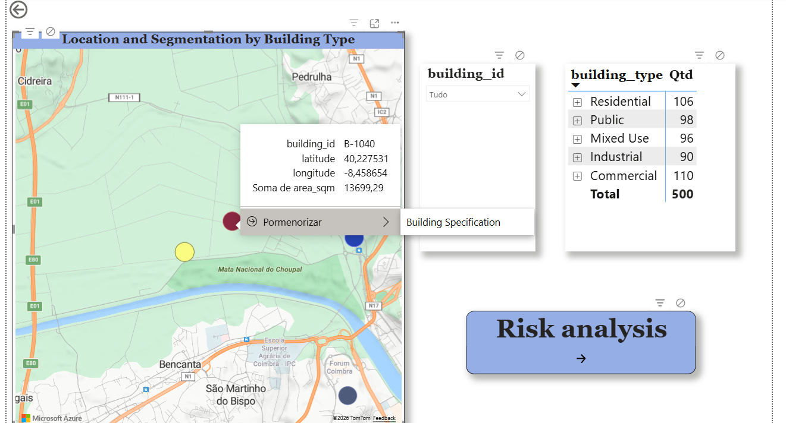
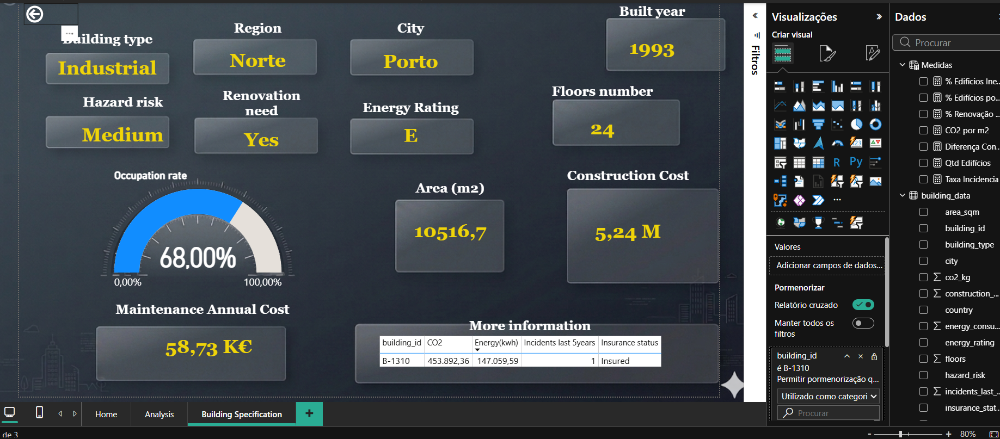
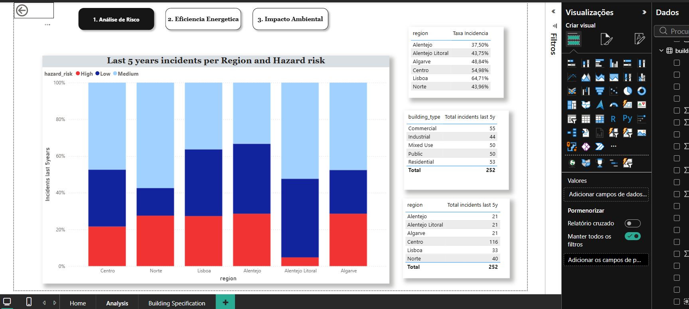
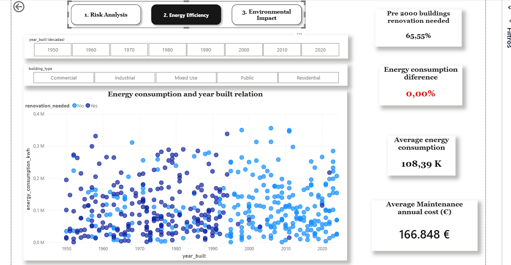
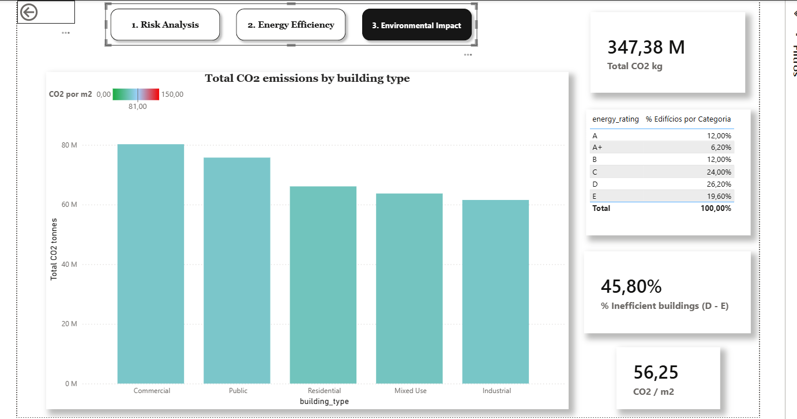

# Infrastructure Operational Management, Risk & Energy Efficiency Dashboard

[](https://powerbi.microsoft.com/)
[](https://learn.microsoft.com/dax/)
[](https://learn.microsoft.com/power-query/)

---

## Executive Summary

This project presents an interactive multi-level Power BI analytics platform designed to monitor **500 building assets** across Portugal.

By integrating geospatial mapping, operational risk assessments, and ESG metrics (CO₂ footprint and energy efficiency ratings), the dashboard empowers asset managers and facility leads to transition from static reporting to real-time, data-driven decision making.

---

## Dashboard Navigation & Interface

| Home & Spatial Mapping | Individual Asset Profile |
| :---: | :---: |
|  |  |
| Risk Analysis | Energy Efficiency |
|  |  |
| Environmental Impact |
|  |
---

## Key Features & Dashboard Views

### 1. Spatial Mapping & Portfolio Segmentation (Home)
* **Geospatial Insights:** Integrated **Azure Maps** displaying building locations with color-coded classification by asset category (`building_type`).
* **Dynamic Slicing:** Hierarchical filter linkage enabling seamless cross-filtering between building types, geographic regions, and individual asset IDs.

### 2. Individual Asset Deep Dive (Building Specification)
* **Granular Asset Profile:** Detailed overview featuring built year, floor count, surface area ($\text{m}^2$), and construction cost.
* **Operational KPIs:** Real-time tracking of current **Occupation Rate** (89%), **Annual Maintenance Cost**, and **Hazard Risk Level**.
* **Filter Synchronization:** Multi-page sync rules and drillthrough capabilities enabling contextual navigation from the main map directly to individual building profiles.

### 3. Risk Assessment & ESG Impact (Analysis Views)
* **Incident Dynamics:** 5-year historical breakdown of incident frequencies across regions and risk brackets.
* **Energy Ratings & Retrofits:** Identification of inefficient building stock (Classes D–E) requiring targeted capital expenditure (CapEx) for renovation.
* **Carbon Footprint Tracking:** Analysis of total $\text{CO}_2$ emissions and carbon intensity metrics ($\text{CO}_2/\text{m}^2$) by asset class.

---

## Technical Architecture & Methodology

### 1. Featured DAX Calculations

```dax
-- % Inefficient Buildings (Classes D & E)
% Edificios Ineficientes (D-E) = 
VAR Total = DISTINCTCOUNT(building_data[building_id])
VAR Poluidores = 
    CALCULATE(
        DISTINCTCOUNT(building_data[building_id]), 
        building_data[energy_rating] IN {"D", "E"}
    )
RETURN 
    DIVIDE(Poluidores, Total, 0)

-- % Pre-2000 Buildings Requiring Renovation
% Renovação Pré-2000 = 
VAR TotalEdificiosPre2000 = 
    CALCULATE(
        DISTINCTCOUNT(building_data[building_id]), 
        building_data[year_built] < 2000
    )
VAR EdificiosPre2000ComRenovacao = 
    CALCULATE(
        DISTINCTCOUNT(building_data[building_id]), 
        building_data[year_built] < 2000, 
        building_data[renovation_needed] = "Yes"
    )
RETURN 
    DIVIDE(EdificiosPre2000ComRenovacao, TotalEdificiosPre2000, 0)

-- CO2 Intensity per Square Meter
CO2 por m2 = 
DIVIDE(
    SUM(building_data[co2_kg]), 
    SUM(building_data[area_sqm]), 
    0
)

-- Incident Rate per Asset
Taxa Incidencia = 
DIVIDE(
    SUM(building_data[incidents_last_5y]), 
    DISTINCTCOUNT(building_data[building_id])
)

### 4. Environmental Impact & ESG Compliance
* **Carbon Footprint by Asset Class:** Carbon emissions correlate strongly with building usage, with **Commercial properties** generating the highest CO₂ footprint and **Industrial assets** accounting for the lowest.
* **Portfolio Energy Inefficiency:** A portfolio-wide evaluation reveals that **45.80% of properties are energy inefficient (rated D or E)**. This highlights a critical operational vulnerability and underscores the need for targeted capital expenditure (CapEx) in energy efficiency upgrades to meet EU ESG compliance standards.
